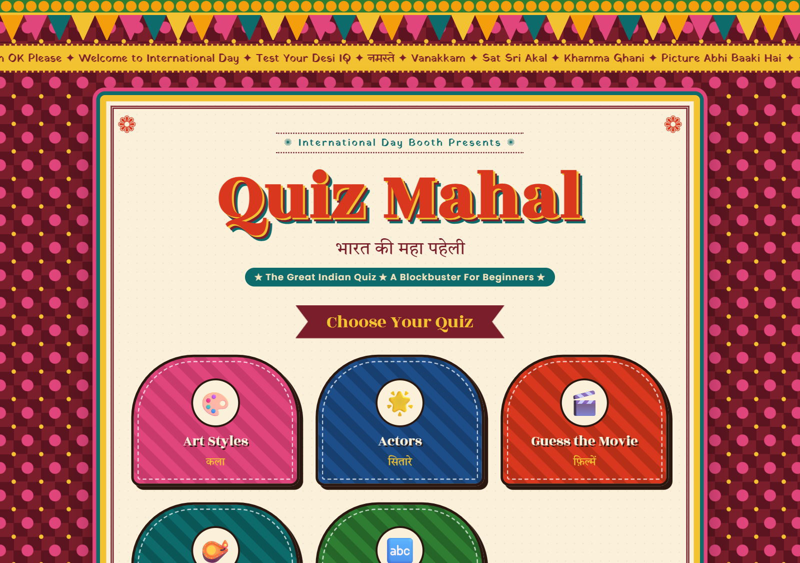
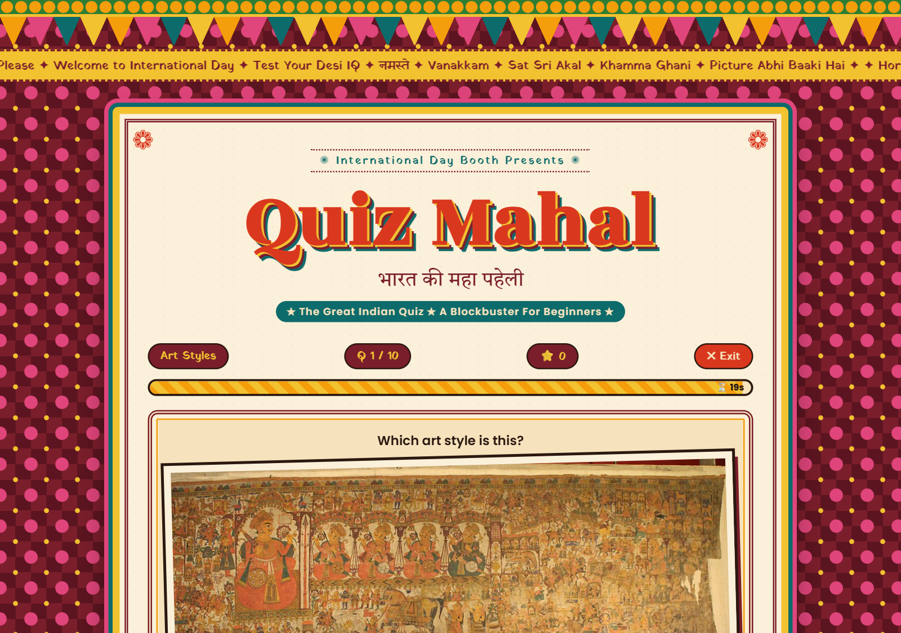
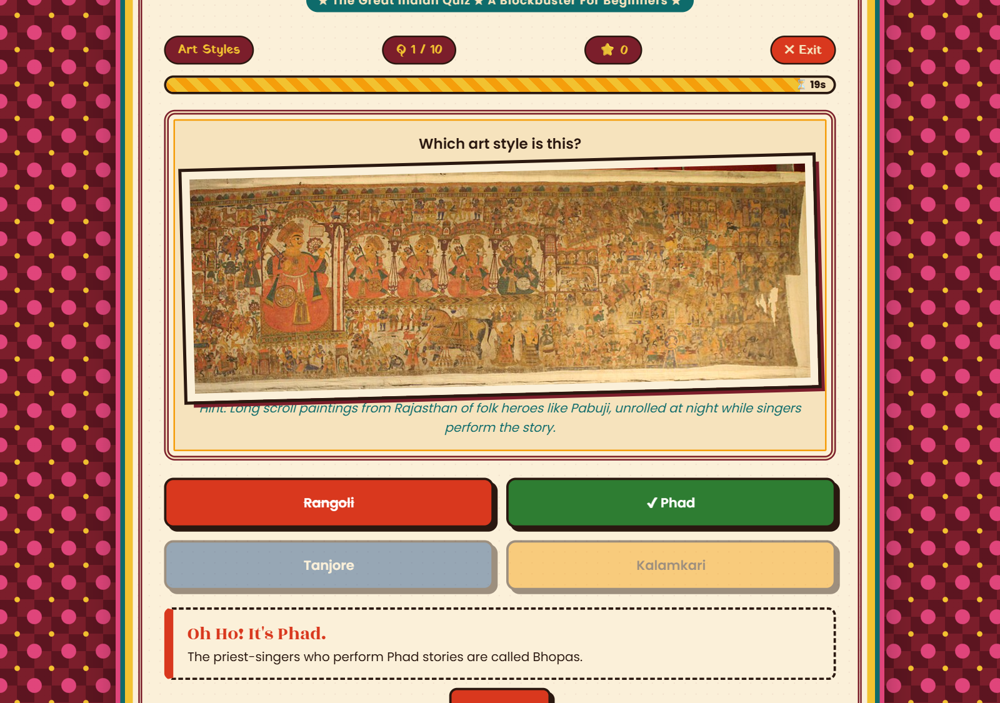
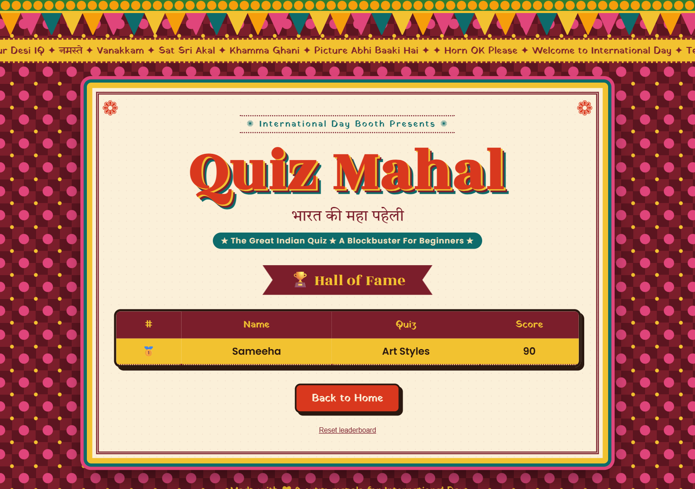

# 🪔 Quiz Mahal: The Great Indian Quiz

**भारत की महा पहेली**: a colourful, Bollywood-poster-style quiz about Indian art, cinema, festivals and languages. It was built for an **International Day booth**, so visitors can walk up, pick a category and play a quick 10-question round.



---

## ✨ Features

- **6 quiz modes, 74 questions**

  | Category | What you do | Questions |
  |---|---|---|
  | 🎨 **Art Styles** | Name the folk or classical art style from a real painting (Madhubani, Warli, Gond, Tanjore and more) | 12 |
  | 🌟 **Actors** | Recognise the star from a photo and a hint | 13 |
  | 🎬 **Guess the Movie** | Decode a film from emojis (🔥🐴🏜️🤝 = *Sholay*) | 16 |
  | 🪔 **Festivals** | Name the festival from a description | 13 |
  | 🔤 **Guess the Language** | Read a phrase and name the script or language (Hindi, Bengali, Tamil and more) | 20 |
  | 🎲 **Random Masala Mix** | A bit of everything | All |

- **Fast rounds:** 10 random questions, 20 seconds each, with a countdown bar
- **Speed bonus:** 10 points for a correct answer plus 1 point for every second left
- **Learn as you play:** every answer reveals a fun fact (*"Madhubani means 'forest of honey'"*)
- **Smart wrong answers:** options are picked automatically from other answers in the same category, so every round is different
- **Hall of Fame leaderboard:** save your name and score; the top 10 are shown and stored in the browser, so a booth laptop keeps the scores all day
- **Desi design:** marigold garland, bunting (toran), a scrolling "Horn OK Please" marquee and Devanagari headings in Rozha One, Yatra One and Tiro Devanagari Hindi fonts

| Question | Answer and fun fact | Leaderboard |
|---|---|---|
|  |  |  |

---

## 🚀 Run it

No installs, no build step. It's plain HTML, CSS and JavaScript.

**Easiest:** open `index.html` in a browser.

**With a local server** (recommended, so images always load):

```bash
python -m http.server 8000
# then open http://localhost:8000
```

**For a booth:** open it full screen (F11) on a laptop or tablet. The leaderboard stays saved in that browser until someone presses *Reset leaderboard*.

---

## ✏️ Add your own questions

All questions live in [`questions.js`](questions.js). Copy a line and change it:

```js
{ question: "Which art style is this?",          // the clue text
  image: "images/art/warli.jpg",                  // optional picture
  big: "🔥🐴🏜️🤝",                                // optional big emoji / text instead of a picture
  hint: "Hint: White stick figures ...",          // optional small clue
  answer: "Warli",                                // the correct answer
  fact: "Warli artists painted with rice paste." } // fun fact shown after answering
```

Wrong options are generated from the other answers in the same category, so there is nothing else to set up.

---

## 🗂️ Project structure

```
├── index.html       # Screens: home, quiz, result, leaderboard
├── style.css        # Bollywood-poster theme, garland, marquee, cards
├── script.js        # Quiz flow, timer, scoring, leaderboard (localStorage)
├── questions.js     # All 74 questions and fun facts
├── images/
│   ├── art/         # Paintings (+ CREDITS.txt)
│   ├── actors/      # Photos (+ CREDITS.txt)
│   └── movies/      # Posters (+ CREDITS.txt)
└── docs/            # README screenshots
```

---

## 🛠️ Built with

- **HTML5, CSS3, vanilla JavaScript**: no frameworks or libraries
- **Google Fonts**: Poppins, Rozha One, Yatra One, Tiro Devanagari Hindi
- **localStorage** for the leaderboard

---

## 📸 Image credits

- **Paintings and actor photos:** Wikimedia Commons. See [`images/art/CREDITS.txt`](images/art/CREDITS.txt) and [`images/actors/CREDITS.txt`](images/actors/CREDITS.txt) for each file's source, author and licence.
- **Film posters:** English Wikipedia (non-free), used only for a non-commercial student quiz booth. See [`images/movies/CREDITS.txt`](images/movies/CREDITS.txt).

All images belong to their respective owners.

---

Made with ❤ &amp; extra masala for International Day by **Sameeha**.
